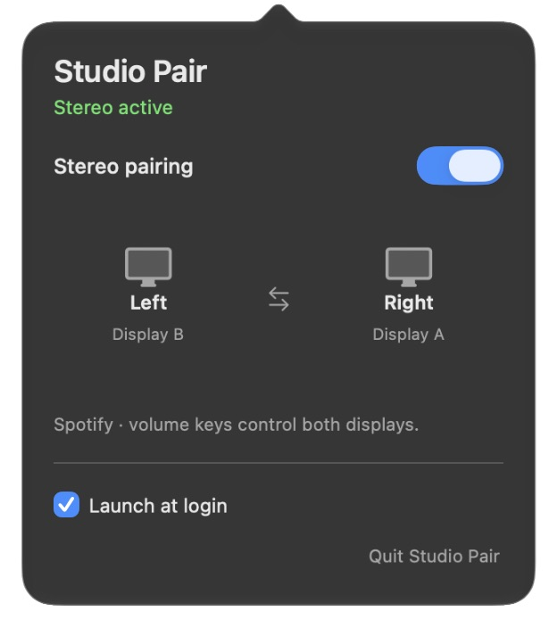

# Studio Pair

**Two Studio Displays. One stereo pair. Your volume keys still work.**

Studio Pair sends Spotify's left channel to one Apple Studio Display and its right channel to the other. A small native macOS menu-bar app lets you swap sides, turn pairing off, and launch at login.



**Early beta. Spotify desktop only.** Other apps keep their normal output. Tested on one Apple silicon Mac with two Studio Displays. This is stereo routing; it does not add Dolby Atmos or guarantee better sound in every room.

## Install with your coding agent

Paste into Codex or Claude Code:

```text
Install Studio Pair from https://github.com/browser-use/studio-pair. Read install.md, check the prerequisites, build it locally, and install it in my user Applications folder. Preserve my audio defaults, volume, microphone, and existing settings. Show me the menu-bar controls and how to undo it. Ask before installing missing development tools. Do not run the hardware tone checks unless I ask.
```

Or, with Xcode Command Line Tools, Rust 1.87+ and Python 3 already installed:

```sh
git clone https://github.com/browser-use/studio-pair.git
cd studio-pair
python3 scripts/manage.py install
```

Requires macOS 14.2+, Spotify desktop, and exactly two Studio Displays exposing eight-channel audio at 48 kHz. Select one Studio Display as your normal sound output, start Spotify, then open Studio Pair. macOS may ask for system audio capture permission. Enable **Launch at login** in the popover if you want it to start automatically.

Builds are local and ad hoc signed. There is no notarized download yet. See [install.md](install.md) for setup and recovery.

## Turn it off

Switch **Stereo pairing** off in the menu bar. Direct Spotify playback returns. Quit also stops the route; the app remembers your pairing preference for its next launch.

```sh
python3 scripts/manage.py stop
```

Unregister launch at login, restore audio and remove the installed app:

```sh
python3 scripts/manage.py uninstall
```

Settings and local recovery metadata are retained. No audio driver is installed.

## How it works

```text
Spotify → private CoreAudio process tap → Rust audio callback
                                         ├─ left  → Studio Display A
                                         └─ right → Studio Display B

Native volume / mute on the selected display → mirrored to the second
```

- Swift/AppKit menu bar, Rust audio engine, Objective-C CoreAudio bridge.
- Private aggregate with clock drift correction. Left/right assignment is saved by device identity.
- No changes to default output, microphone or hardware sample rates.
- A rollback journal tracks secondary volume/mute. Recovery restores those values only if they still match the app's last write.
- No audio files, telemetry, network calls, third-party Rust crates or HAL driver.

## Limits and contributing

The first release handles Spotify only. It needs a Studio Display as the default output, so switching to headphones returns Spotify to direct playback. Unsupported channel layouts or sample rates are rejected. The route uses -6 dB software headroom, so compare sound at matched listening volume.

Clock drift correction is enabled and checked; acoustic synchronization has not been measured. Sleep/wake, unplug/reconnect, reboot login and long listening sessions still need broader testing. The macOS 14.2 deployment target is compiled in; actual hardware testing was on macOS 27.0.

[Architecture and recovery](docs/architecture.md) · [Validation](docs/validation.md) · [Contributing](CONTRIBUTING.md)

MIT licensed. Built for a two-display desk that should have been a stereo system already.
