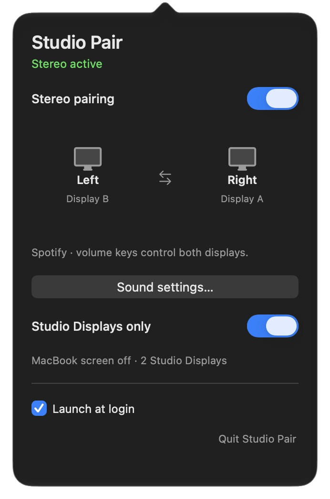

# Studio Displays only

The menu switch turns off the MacBook's built-in display while at least two
Apple Studio Displays are active. It works with the lid open and independently
of stereo pairing. The preference defaults off and survives app relaunches.

Turning the switch off, quitting Studio Pair, losing either Studio Display, or
losing the app process restores the built-in display. Closing the lid already
disables that display; Studio Pair leaves that case alone.



The screenshot includes pre-existing personal sound controls, outside this change.

## Recovery and compatibility

The app starts a small display helper before disabling the panel. The helper
watches its owner's pipe and checks the external displays every 250 ms. EOF,
SIGTERM, or loss of a required display triggers restoration. The helper continues
trying if macOS temporarily refuses restoration, for example during sleep.
The app also records the owned display ID before launching the helper and
attempts recovery after a helper crash or app restart.

The implementation dynamically resolves macOS's private
`CGSConfigureDisplayEnabled` function. It uses session-only configuration, checks
the resulting display state, and fails without disabling the panel when the
function is unavailable or the required displays are absent. A future macOS
release can change this private API. No driver or privileged service is installed.

Only Apple Studio Display product 0xae3a from vendor 0x610 counts toward the
requirement; mirrored and inactive screens do not count. Other display models
are deliberately outside this feature's scope. Audio devices, speaker routing,
sample rates, volume, brightness, and external display modes are untouched.

## Verification

Build normally. With both Studio Displays connected and the built-in panel on:

```sh
python3 tests/display_check.py --hardware
```

This opt-in check temporarily disables the built-in panel and verifies that it
returns after both an orderly owner disconnect and an owner SIGKILL. A `finally`
path explicitly restores it on test failure. It does not play test audio.

On the development Mac, the real app switch, app SIGKILL recovery, and automatic
mode after relaunch were also checked. Physical unplug/reconnect and system
sleep/wake have not been tested. Those paths use the same helper restoration
mechanism but are not established by the process tests.

## Rollback

Turn off **Studio Displays only** before replacing the app with an older build.
Quit the app to restore the panel even when the menu is unavailable. Recovery can
also be invoked with the saved built-in display ID:

```sh
"Studio Pair.app/Contents/MacOS/studio-pair-display" --restore DISPLAY_ID
```

The helper only enables a display in this mode. It does not disable anything.
